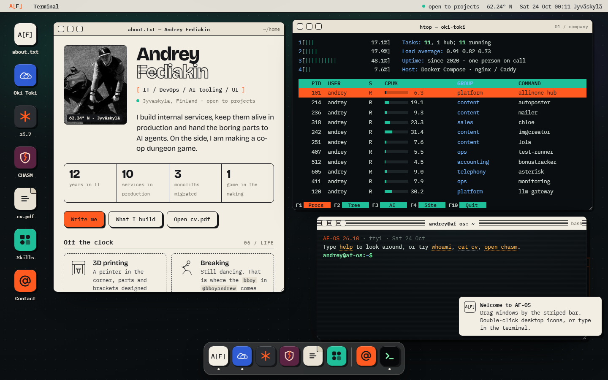
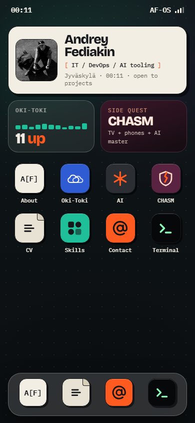

# AF-OS

Personal site of **Andrey Fediakin**: IT, DevOps and AI tooling, based in Jyväskylä, Finland.

**Live:** https://bboyandrew.github.io

The site is a small desktop operating system that runs in the browser. Each section is an app
in its own window: the about page, Oki-Toki services as a live `htop`, AI work as a man page,
the CHASM game, the CV, skills and contacts. A terminal with real commands ties it together.



<p align="center"></p>

## Features

- **Boot sequence.** About 1.5 seconds, skipped by any key or click. Runs once per session;
  run it again with *Reboot* in the A[F] menu.
- **Window manager.** Drag by the title bar, focus, minimize to the dock, maximize with a
  double-click, close, resize from the corner.
- **Oki-Toki as `htop`.** Every internal service is a process with a live CPU bar.
  Select a row to see what the service does; `F2` switches to a tree grouped by area.
- **Terminal.** Working commands with Tab completion and history (see below).
- **CHASM window.** A tiny playable floor of the dungeon game: arrows or WASD to move.
- **Mobile.** On narrow screens the desktop becomes a phone home screen, and apps open
  as full-screen sheets.
- **Accessibility.** `prefers-reduced-motion` turns off the boot sequence and animations.

## Terminal commands

| Command | What it does |
|---|---|
| `help` | List commands |
| `whoami` | Short bio |
| `ls [dir]` | List files |
| `cat cv` / `about` / `skills` / `ai` / `hobbies` / `contact` | Print a section |
| `open <app>` | Open an app window |
| `htop`, `man ai` | Open Oki-Toki services or the AI page |
| `neofetch` | System summary |
| `date`, `history`, `clear` | The usual |
| `reboot` | Run the boot sequence again |

One command is not in `help`. Finding it is left to the reader.

## Project structure

```
src/index.html    source page: HTML, CSS and JS in one file
img/              images, referenced from the source as {{img:name}}
build.py          inlines images as base64 into a single self-contained file
index.html        built page that GitHub Pages serves
docs/             screenshots for this README
```

## Build

Python 3 is the only requirement.

```bash
python build.py
cp dist/andrey-fediakin.html index.html
```

`build.py` replaces every `{{img:name}}` placeholder with the matching `img/name.jpg` as a
data URI and writes `dist/andrey-fediakin.html`. Copying it to `index.html` publishes it.

## Deploy

GitHub Pages serves `index.html` from the root of the `main` branch. Push to `main`, and the
site updates within about a minute.

## Tech

Plain HTML, CSS and JavaScript with no framework, no build tooling and no runtime dependencies.
The only external resource is Google Fonts (Bricolage Grotesque, IBM Plex Mono).

## Contact

- Email: fediakin.andrey@gmail.com
- GitHub: [@bboyandrew](https://github.com/bboyandrew)
- Instagram: [@afediakin](https://instagram.com/afediakin/)

## License

© 2026 Andrey Fediakin. All rights reserved. The code is public for reading and reference;
the content and images may not be reused without permission.
